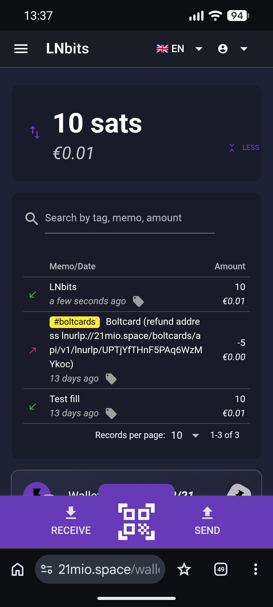
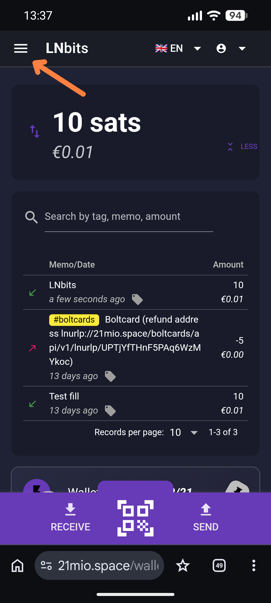
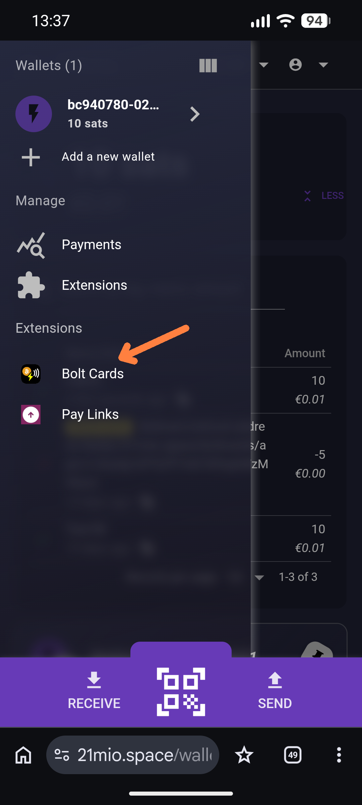
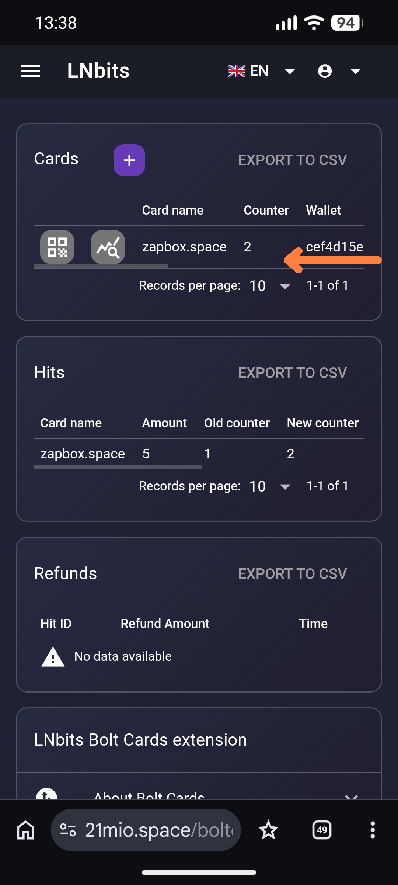
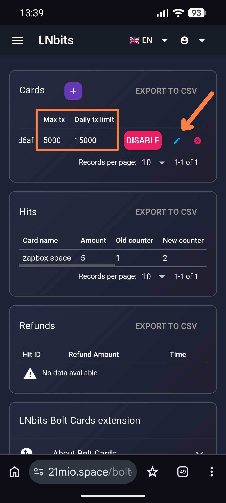
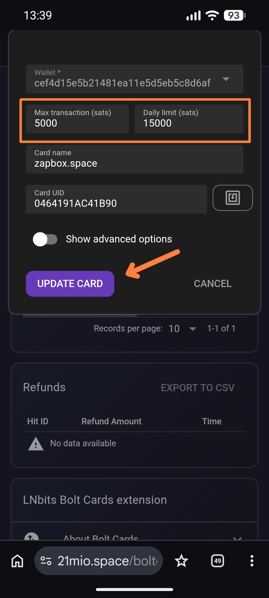

# Bolt Cards – Bitcoin ⚡ Lightning Wallet 

The **Bolt Card** is a modern NFC chip in a card format. It contains the access credentials to a Bitcoin wallet. When you hold the card to a device or a smartphone with NFC, the data is read and payments are authorized.

There are blank Bolt Cards that you have to link to a Lightning wallet yourself. And there are **pre-installed Bolt Cards** – this handout is intended for those, to help you understand usage, settings and risks.

> **Important notes:** 
> The Bolt Card is a service provided to you. You receive a Bolt Card and a Bitcoin Lightning web wallet. In the background, an LNbits server is running that is maintained by someone. As soon as you transfer deposits to the wallet of the Bolt Card, they are held in custody by that person, since they operate the server. You therefore have to trust them to make your Bitcoin accessible to you again. So only keep as much on the Bolt Card wallet as you would be willing to donate in an emergency.

---

## Table of Contents

1. [Your Pre-installed Bolt Card](#your-pre-installed-bolt-card)
2. [The LNbits Wallet](#the-lnbits-wallet)
3. [Topping Up the Wallet – the Lightning ATM](#topping-up-the-wallet--the-lightning-atm)
4. [Paying with the Bolt Card at ZapBox Machines](#paying-with-the-bolt-card-at-zapbox-machines)
5. [Bolt Card Settings](#bolt-card-settings)
6. [Further Information](#further-information)

---

## Your Pre-installed Bolt Card

On the front of your Bolt Card you will find:

- **ZAPBOX.SPACE** – the link to a website presenting the technology that can process Bolt Cards.
- **Batch and serial number** – printed directly below. Every Bolt Card is unique and can be identified by this number.
- **QR code** – the direct link to your personal Lightning wallet.

### Scan the QR Code and Open the Wallet

Scan the QR code with your smartphone. It leads directly to a Lightning wallet on an LNbits server that processes your payments.

> ⚠️ **Two important notes:**
>
> 1. **Save the link** – e.g. in a note on your smartphone or PC. This way you always have access to your wallet, even without the Bolt Card. The wallet is particularly convenient to use on a PC monitor.
>
> 2. **Protect the QR code** – Don't let anyone hold the card or scan the QR code. The QR code is an **open wallet access**: anyone who gets access can steal all funds.

---

## The LNbits Wallet

After you have scanned the QR code and opened the wallet, you will notice that the mobile view is a bit compact – but the basic operation is quite simple.

  

    
  

  

| Area | Function |
|---|---|
| **Top – Amount** | Shows the current balance in satoshis (sats). 100,000,000 sats = 1 Bitcoin. An empty wallet shows `10 sats`. |
| **Middle – Transactions** | Green arrow = incoming · Red arrow = outgoing (payment) |
| **Bottom – Actions** | `RECEIVE` to receive (create an invoice) · `SEND` to pay · **QR code icon** in the middle for direct camera scan |

### Navigation & Settings

- **☰ Hamburger menu** (top left, next to the LNbits logo) – here you will find extensions. The **Bolt Cards** item is relevant if you want to change settings for the card.
- **Top right** – change language and manage your account. If you own several Bolt Cards, you first have to log out here before opening another wallet. Only one wallet can be logged in at a time in the browser – otherwise a **404 error** appears. Solution: log out of the current wallet, then open the new link.
  

---

## Topping Up the Wallet – the Lightning ATM

Before you can use the Bolt Card, the wallet has to be filled with satoshis. One option is **small Lightning ATMs**, which offer a practical introduction to Lightning technology. The procedure:

1. Insert e.g. 10 cents into the ATM.
2. After the amount is displayed, press the **LED button** to confirm the withdrawal.
3. Open your Bolt Card wallet and tap the **QR code icon** to activate the camera.
4. Scan the QR code of the ATM and confirm the withdrawal.
5. Shortly afterwards, the satoshis equivalent to the inserted coins appear in your wallet.

> ℹ️ The ATM works offline and does not directly notice the withdrawal. Since the LED button blinks afterwards, press it once to release the ATM for the next person.

---

## Paying with the Bolt Card at ZapBox Machines

ZapBox machines have an **NFC module**, recognizable by the **))** symbol. Some machines also have a display and show a QR code.

### Payment via Bolt Card (NFC) – the easiest way

1. Check that the device is active: a QR code is displayed, or an LED is permanently lit.
2. Hold the **Bolt Card** to the NFC module for at least two seconds.
3. The display shows **PENDING NFC**, or an LED blinks. The payment is being prepared in the background.
4. After a successful payment, the **ACTION screen** appears or the **ACT LED** blinks – the product is dispensed.

### Payment via QR Code (alternative)

The classic way to pay a Lightning invoice is to **scan the QR code** on the machine:

1. Open your wallet and tap the QR code icon in the middle.
2. Allow camera access if prompted.
3. Point the camera at the QR code of the machine.
4. Confirm the payment – done.

## Bolt Card Settings

The Bolt Card has several protection mechanisms. There is a limit per transaction and a daily limit. The defaults are 5,000 satoshis per transaction and 15,000 satoshis per day. These values can be adjusted individually. 

  
  
  
  
  

1. Select the hamburger icon (☰) at the top left to open the menu
2. Select **Bolt Cards**
3. Swipe the row with zapbox.space to the left to get to the edit area
4. Click the small **blue pencil** (edit icon)
5. Edit **Max transaction** and/or **Daily limit** and confirm with **UPDATE CARD**

In this area you can also set the card to **DISABLE** and re-activate it later with **ENABLE**.

## Further Information

You can find more information about the Bolt Card and general information about Bitcoin and Lightning at [ereignishorizont.xyz](https://ereignishorizont.xyz/en/boltcard_en/).

| Resource | Link |
|---|---|
| Setting up Bolt Cards | https://ereignishorizont.xyz/en/boltcard_en/ |
| ereignishorizont.xyz - Onboarding | https://ereignishorizont.xyz/en/onboarding_en/|
| ZapBox - Bitcoin ⚡Lightning Switch | https://zapbox.space/ |
| LNbits - Wallet and Account System | https://lnbits.com/ |

---

*With kind regards from **[zapbox.space](https://zapbox.space)*** - Version: bch972185 | Language: English
