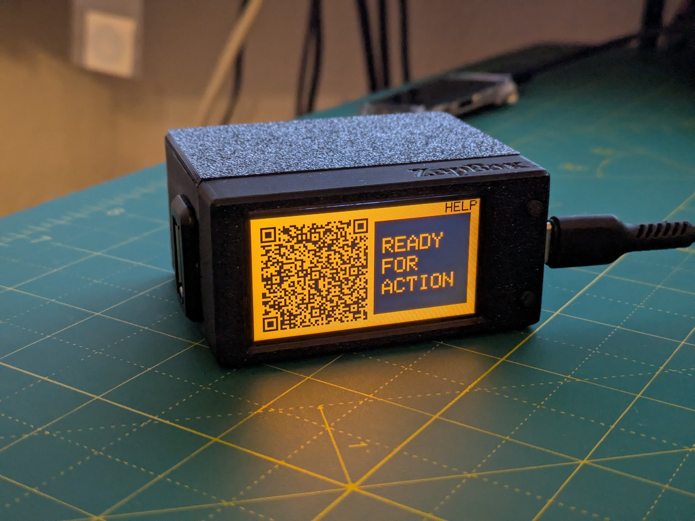

# ZapBox White Paper

**Bitcoin Lightning Network-Controlled IoT Device Management**

Version wp930750 | January 3, 2026  
🌐 Website: [zapbox.space](https://zapbox.space/) | 💻 GitHub: [AxelHamburch/ZapBox](https://github.com/AxelHamburch/ZapBox)

---

## Abstract

ZapBox is an open-source hardware and software solution that enables the control of physical devices via Bitcoin Lightning payments. By combining an ESP32 microcontroller with a display, relays, and a WebSocket-based backend infrastructure, ZapBox creates a bridge between Bitcoin payments and real-world IoT device control. This white paper describes the technical architecture, implementation details, use cases, and the vision behind the project.

<p align="center">
  
</p>

<p align="center">
  <i>ZapBox Prototype #001</i>
</p>

---

## Table of Contents

1. [Introduction](#1-introduction)
2. [Problem Statement](#2-problem-statement)
3. [Technical Architecture](#3-technical-architecture)
4. [Hardware Specifications](#4-hardware-specifications)
5. [Backend Infrastructure](#5-backend-infrastructure)
6. [Payment Flow](#6-payment-flow)
7. [Installation and Configuration](#7-installation-and-configuration)
8. [Operating Modes](#8-operating-modes)
9. [Security and Reliability](#9-security-and-reliability)
10. [Use Cases](#10-use-cases)
11. [Open-Source Ecosystem](#11-open-source-ecosystem)
12. [Roadmap and Future Perspectives](#12-roadmap-and-future-perspectives)
13. [Conclusion](#13-conclusion)
14. [References](#14-references)

**Appendices**
- [Appendix A: Technical Glossary](#appendix-a-technical-glossary)
- [Appendix B: Versioning](#appendix-b-versioning)

---

## 1. Introduction

The digitalization of payment processes has made significant progress in recent years. The Bitcoin Lightning Network, as a Layer-2 solution on the Bitcoin blockchain, offers the ability to conduct microtransactions virtually free of charge and in real-time. ZapBox leverages this technology to create an interface between digital payments and physical device control.

### Vision

**"We want to make Bitcoin Lightning technology ⚡ accessible to everyone – worldwide. 🌍"**

ZapBox lowers the barriers to entry for using Bitcoin Lightning in the Internet of Things (IoT) and enables anyone – from hobbyists to professional users – to realize their own Lightning-controlled applications.

---

## 2. Problem Statement

Despite the enormous potential of the Lightning Network, several barriers exist for its widespread adoption in the IoT sector:

- **Technical Complexity**: Integration of Lightning payments into hardware projects requires deep technical knowledge
- **Lack of Standard Solutions**: Few ready-made solutions exist that integrate hardware, software, and backend
- **Rapid Development**: Software development is now so fast that solutions working today may become obsolete tomorrow
- **Accessibility**: Non-technical users cannot readily utilize the technology
- **Hardware Integration**: The connection between payment receipt and physical action is complex

ZapBox addresses these challenges through a fully integrated, user-friendly solution.

---

## 3. Technical Architecture

### 3.1 System Overview

```
┌─────────────────┐
│  Lightning      │
│  Wallet         │
│  (User)         │
└────────┬────────┘
         │ QR-Code Scan
         │ LNURL
         ▼
┌─────────────────┐
│  LNbits Server  │
│  + ZapBox       │
│  Extension      │
└────────┬────────┘
         │ WebSocket
         ▼
┌─────────────────┐        ┌──────────────┐
│  ZapBox         │───────►│  Relay       │
│  (ESP32)        │        │  Control     │
└─────────────────┘        └──────────────┘
         │                          │
         ▼                          ▼
┌─────────────────┐        ┌──────────────┐
│  Display        │        │  External    │
│  (QR-Code)      │        │  Device      │
└─────────────────┘        └──────────────┘
```

### 3.2 Components

**Frontend (Hardware)**
- ESP32 microcontroller with display (T-Display-S3)
- Relay modules
- Slide switches for pre-selection
- Onboard button or external (LED) buttons optional
- Optional in planning: NFC support (PN532)

**Frontend (Software)**
- Web Installer
- ZapBox Firmware

**Backend (Software)**
- LNbits Server (Wallet & Account System)
- ZapBox Extension (zapbox_extension)
- WebSocket server (LNbits) for real-time communication

**Communication**
- WiFi (2.4 GHz)
- WebSocket protocol
- LNURL standard

---

## 4. Hardware Specifications

### 4.1 Core Components

**Microcontroller: ESP32 / T-Display-S3**
- ESP32-S3R8 Dual-core LX7 microprocessor
- Flash 16 MB / PSRAM 8 MB
- WiFi 802.11 b/g/n
- Low power consumption
- Deep-sleep mode available

**T-Display-S3 Display**
- 1.9 inch ST7789 LCD Display (Resolution: 170x320)
- Optional: Capacitive touchscreen (CST816S)
- High-resolution QR-code display
- Configurable color schemes

**Relay Module**
- 5V relay / High-level trigger
- Switching voltage: up to 250V AC / 30V DC
- Switching current: up to 10A (up to 30A with high-power relays)
- Galvanic isolation

### 4.2 Physical Design

The hardware is available in three main variants, with more to follow.

- **ZapBox Compact**: Single relay, compact design
- **ZapBox Duo**: Two relays, one power relay with external terminals
- **ZapBox Quattro**: Four relays with external connection terminals for professional applications
- **ZapBox Mini**: In planning... As small as possible

All variants feature:
- 3D-printable enclosures (FreeCAD files available)
- Electrical design documentation (E-layout)
- Simplified bill of materials in E-layout

And are compatible with the ZapBox firmware from the Web Installer.

---

## 5. Backend Infrastructure

### 5.1 LNbits Server

LNbits is an open-source Lightning Network wallet and account system. It offers:

- Multi-user wallet management
- Extensible plugin architecture
- REST API
- WebSocket support
- Lightning node abstraction

### 5.2 ZapBox Extension

The ZapBox Extension extends LNbits with IoT control functionalities:

- **Device Management**: Management of multiple ZapBox devices
- **Invoice Generation**: Automatic invoice creation
- **WebSocket Bridge**: Real-time communication with devices
- **Event Tracking**: Logging of all switching operations
- **Multi-Channel Support**: Management of multiple outputs per device

### 5.3 Device String

Each ZapBox is identified by a unique "Device String" that:
- Authenticates the connection to the LNbits server
- Identifies the specific device
- Specifies the output to be controlled
- Is configured in the firmware

---

## 6. Payment Flow

### 6.1 LNURL Protocol

The QR-code displayed on the screen uses the LNURL protocol (Lightning URL), a standard for Lightning Network interactions. The QR-code contains:

1. Server URL of the LNbits backend
2. Device identification
3. Channel/output specification

### 6.2 Transaction Flow

```
1. ZapBox displays QR-Code (LNURL)
   └─> Contains: Server-URL + Device-ID + Channel

2. User scans QR-Code with Lightning Wallet
   └─> Wallet contacts LNbits Server

3. LNbits checks WebSocket connection to ZapBox
   └─> Confirms device availability

4. LNbits generates Invoice
   └─> Sends to wallet with amount & description

5. User confirms payment in wallet
   └─> Lightning payment is executed

6. LNbits confirms payment receipt
   └─> Sends event via WebSocket to ZapBox

7. ZapBox receives event
   └─> Switches relay for defined duration

8. Relay opens/closes circuit
   └─> External device is activated
```

### 6.3 Timing and Performance

- **Payment Confirmation**: ~2-15 seconds (Lightning)
- **Event Transmission**: < 500ms (WebSocket)
- **Relay Response**: < 50ms
- **Total Duration (Scan to Switching)**: ~2-20 seconds

---

## 7. Installation and Configuration

### 7.1 Web Installer

ZapBox uses a browser-based installer: **https://installer.zapbox.space/**

Advantages:
- No software installation required
- Platform-independent (Windows, macOS, Linux)
- Uses Web Serial API
- Visual feedback during flashing process
- Log terminal for status display

Note: Chromium browser required, such as Google Chrome, Microsoft Edge, Opera, Vivaldi and Brave, but also specialized ones like Ungoogled Chromium, Samsung Internet.

### 7.2 Installation Process

**Preparation: Creating an LNbits Account**
1. Create an account on an LNbits server
2. Enable the extension under "Manage > Extensions > ZapBox"
3. Go to "Extensions > ZapBox" and create a "NEW ZAPBOX INSTANCE" with GPIO-Pin 12 and your personal settings
4. You will then find the "Device string" as a small triangle with a gear icon

**Step 1: Firmware Flash**
1. Connect ZapBox via USB (ESP32 port!)
2. Open Web Installer
3. Select firmware version
4. Click "Flash" button
5. Select communication interface in pop-up window and connect
6. Follow instructions, confirm and wait for flashing process
7. Then close the window

**Step 2: Configuration**
1. ZapBox starts automatically in "CONF" mode after first flashing
2. Select "Connect" in Web Installer under point 3
3. Select communication interface in pop-up window and connect
4. Enter the three mandatory parameters:
- **SSID**: WiFi network name
- **Password**: WiFi password
- **Device String**: From the LNbits ZapBox Extension
5. Press "Write Config" button once and then "Restart" button
6. ZapBox restarts and is ready after a few seconds. 🎉

Optional Parameters:
- **Display Orientation**: 0°, 90°, 180°, 270°
- **Color Scheme**: Background and text colors
- **QR-Code Format**: LNURL as bech32 or LUD17
- **Screensaver**: After timeout, by deactivating backlight
- **Deep Sleep**: Maximum power saving mode, for battery operation
- **Special Modes**: Special, Multi-Channel, BTC-Ticker, Threshold

---

## 8. Operating Modes / Settings

The ZapBox can be customized individually depending on the version used - Compact, Duo or Quattro - via the Web Installer and parameterization in the LNbits wallet.

By default, this is the Compact version with one relay. In LNbits, GPIO Pin 12 is set for this. The currency, amount, switching duration and the text displayed next to the QR-code (Field: Label) must also be specified here.

The operating modes can be set via the Web Installer page when the ZapBox is connected to the computer via USB (on ESP32) and displays the "CONF" mode. The following modes can be set:

- **Special Mode**: Trigger signal as Blink, Pulse, Strobe, Custom
- **Multi-Channel Mode**: Single, Duo, Quattro
- **BTC-Ticker Mode**: Optionally displays a BTC ticker with block time. Fiat currency freely selectable.
- **Threshold Mode**: Switch when threshold is reached -> For e.g. Lightning addresses or Nostr Zaps

---

## 9. Security and Reliability

### 9.1 Security Aspects

**Network Security**
- TLS/SSL encrypted WebSocket connection
- WPA2-protected WiFi
- No private keys on device
- Device String as sole authentication

**Payment Security**
- Lightning Network native security
- Atomic transactions
- No chargebacks
- Invoice-based system

### 9.2 Reliability

**Error Handling**
- Automatic WiFi reconnection
- WebSocket reconnection with backoff
- Watchdog timer
- Error logging on display

**Monitoring**
- Connection status on display
- Error status displayed directly
- Optional: Remote monitoring via LNbits

**Maintenance**
- Easy updates
- Diagnostic mode

---

## 10. Use Cases

### 10.1 Commercial Applications

**Vending Machines**
- Beverage machines
- Snack machines
- Washing machines/dryers in laundromats
- Lockers

**Access Controls**
- Door openers
- Parking barriers
- Charging stations (e-bike, e-scooter)
- Co-working spaces

**Services**
- Air pumps at gas stations
- Vacuum cleaners at car washes
- Massage chairs
- Showers (campgrounds, beach resorts)

### 10.2 Education and Demonstration

**Workshops**
- Bitcoin Lightning training
- IoT development with micropayments
- Maker spaces and hackerspaces

**Exhibitions**
- Hands-on Lightning demonstrations
- Bitcoin conferences
- Tech fairs

### 10.3 Private Use

**Smart Home**
- Light control (gamification)
- Garage door opener for guests
- Home automation with Bitcoin trigger

**Games and Challenges**
- Escape room puzzles
- Bitcoin trivia machines
- Reward systems

### 10.4 Social Projects

**Crowdfunding**
- Threshold mode for community projects
- Public art installations
- Charity events

**Decentralization**
- P2P resource sharing without central management
- Community-operated infrastructure

---

## 11. Open-Source Ecosystem

### 11.1 Licensing

ZapBox is fully open source under MIT License available on GitHub:

**GitHub:** https://github.com/AxelHamburch/ZapBox

**Hardware**
- Electrical schematics: [GitHub](https://github.com/AxelHamburch/ZapBox) ../assets/electric
- 3D models (FreeCAD): [GitHub](https://github.com/AxelHamburch/ZapBox)  ../assets/housing

**Software**
- Firmware: [GitHub](https://github.com/AxelHamburch/ZapBox) ../releases
- Web Installer: [GitHub](https://github.com/AxelHamburch/ZapBox) ../installer

**Documentation**
- Documentation: [GitHub](https://github.com/AxelHamburch/ZapBox) readme.md
- White Paper: [GitHub](https://github.com/AxelHamburch/ZapBox) ../assets/white-paper
- Website: https://zapbox.space/

### 11.2 Repository Structure

**GitHub Repository**: https://github.com/AxelHamburch/ZapBox

```
ZapBox/
├── .vscode/               # VS Code configuration
├── assets/                # Hardware designs & documentation
│   ├── electric/         # Electrical schematics
│   ├── housing/          # 3D models for enclosures
│   └── white-paper/      # White paper documents
├── include/               # Header files
├── installer/             # Web Installer
│   ├── assets/           # Web Installer assets
│   ├── firmware/         # Firmware versions for Web Installer
│   └── index.html        # Web Installer main file
├── lib/                   # Libraries and dependencies
│   └── TFT_eSPI_Setup/   # Display configuration
├── src/                   # Firmware source code
│   ├── main.cpp          # Main program
│   ├── Display.cpp/h     # Display control
│   ├── Network.cpp/h     # Network & WebSocket
│   ├── Payment.cpp/h     # Payment logic
│   ├── UI.cpp/h          # User interface
│   └── ...               # Additional modules
├── FIRMWARE.md            # Firmware documentation
├── LICENSE                # MIT License
├── platformio.ini         # PlatformIO configuration
└── README.md              # Project documentation
```

### 11.3 Used Open-Source Projects

**Backend**:
- **LNbits** (MIT): https://github.com/lnbits/lnbits
- **ZapBox Extension** (MIT): https://github.com/AxelHamburch/zapbox_extension (fork of https://github.com/lnbits/bitcoinswitch_extension)

**Firmware Libraries**:
- ESP32 Arduino Core
- TFT_eSPI (Display)
- ArduinoJson
- WebSocketsClient
- WiFiManager

### 11.4 Community Contributions

The project thrives on community contributions:
- Bug reports and feature requests via GitHub Issues
- Pull requests for improvements
- Hardware variants and customizations
- Translations
- Documentation

---

## 12. Roadmap and Future Perspectives

### 12.1 Short to Medium-term Vision

**Software / Firmware**
- NFC support
- OTA update functionality
- Monitoring dashboard
- Additional features...

**Hardware**
- Stable rollout and availability of all three versions
- Evaluate ZapBox Mini and other possible combinations

**Website**
- Make zapbox.space really great

---

## 13. Conclusion

ZapBox represents a significant step in connecting Bitcoin Lightning Network with the Internet of Things. Through the combination of user-friendly hardware, robust software, and a fully open-source approach, the project makes Lightning payments accessible for physical applications.

### Core Advantages

1. **Accessibility**: Drastically lowers technical barriers
2. **Decentralization**: No central intermediaries required
3. **Costs**: Microtransactions without significant fees
4. **Speed**: Real-time payments and reactions
5. **Open Source**: Complete transparency and customizability
6. **Scalability**: From individual devices to large installations

### Significance for the Lightning Ecosystem

ZapBox demonstrates the potential of Lightning beyond pure peer-to-peer payments. Enabling machine-to-machine payments and IoT integration opens new application fields:

- **Circular Economy**: Bitcoin as native payment method in automated systems
- **Programmable Money**: Payments that automatically trigger actions
- **Micropayment Infrastructure**: Foundation for pay-per-use business models

### Call for Participation

The project invites everyone to become part of the development:
- **Developers**: Contribute to firmware and software
- **Hardware Designers**: Develop new variants and enclosures
- **Users**: Share your use cases and feedback
- **Companies**: Integrate ZapBox into your products

**"Everyone should be able to build the ZapBox themselves. But many won't be able or willing to do so. We want to make Bitcoin Lightning technology ⚡ accessible to everyone – worldwide. 🌍"**

---

## 14. References

### Technical Specifications

- **Lightning Network**: https://lightning.network/
- **LNURL Protocol**: https://github.com/lnurl/luds
- **T-Display-S3 LILYGO**: https://lilygo.cc/products/t-display-s3

### Open-Source Projects

- **ZapBox GitHub**: https://github.com/AxelHamburch/ZapBox
- **LNbits**: https://github.com/lnbits/lnbits
- **ZapBox Extension**: https://github.com/AxelHamburch/zapbox_extension
- **T-Display-S3 Github**: https://github.com/Xinyuan-LilyGO/T-Display-S3

### Further Information

- **ZapBox Website**: https://zapbox.space
- **ZapBox GitHub**: https://github.com/AxelHamburch/ZapBox
- **Web Installer**: https://installer.zapbox.space
- **Bitcoin Switch (Ben Arc)**: https://github.com/lnbits/bitcoinSwitch

### Contact

- **Community Group**: https://t.me/ZapBoxDotSpace
- **Repository Issues**: https://github.com/AxelHamburch/ZapBox/issues
- **Email**: info@zapbox.space

---

## Appendix A: Technical Glossary

- **ESP32**: Microcontroller from Espressif with WiFi and Bluetooth
- **Lightning Network**: Layer-2 protocol for fast Bitcoin transactions
- **LNURL**: Lightning URL Protocol for simplified interactions
- **Invoice**: Lightning invoice for a payment
- **WebSocket**: Bidirectional communication protocol
- **Relay**: Electromechanical switch
- **OTA**: Over-The-Air (wireless firmware updates)
- **FOSS**: Free and Open Source Software

---

## Appendix B: Versioning

**Firmware Versions**:
- v9.x.x: Current major version
- Semantic versioning (MAJOR.MINOR.PATCH)
- Release notes in GitHub repository

**Hardware Revisions**:
- Electrical schematics: eXXXXXX-compact
- Enclosures: bXXXXXX-compact
- Complete history in Git

---

*This document was created on January 3, 2026, and is regularly updated. The latest version is always available in the GitHub repository.*

---

**ZapBox - Open Source Bitcoin Lightning IoT**

⚡ Powered by the Lightning Network | 🌍 Available Worldwide | 🔓 Fully Open Source
